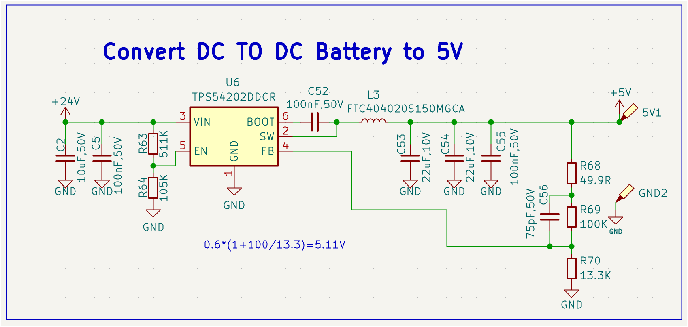

# 电容与电感基础及 BUCK 电感选型

整理日期：2026-11-13  
内容来源：本次对话。由基础概念逐步过渡到 TPS54202 降压电源的电感选型；数值计算为理想化估算，不代替最终设计验证。

## 1. 先建立整体认识

| 元件 | 核心作用 | 能量或损耗 | 理想稳态直流表现 |
|---|---|---|---|
| 电阻 | 限制电流，产生压降 | 将电能转为热 | 有电流就有压降 |
| 电容 | 缓冲电压变化 | 以电场形式储能 | 电压不变时没有电流，相当于断路 |
| 电感 | 缓冲电流变化 | 以磁场形式储能 | 电流不变时没有压降，相当于短路 |

直观类比：电阻像狭窄水管；电容像能缓冲水压的储水装置；电感像被水流带动的重飞轮，阻碍流速突然改变。

> 记忆：电容电压不能突变，电感电流不能突变。这里默认电流、电压有限；实际器件还存在寄生参数和损耗。

## 2. 电感名称为什么容易混淆？

“功率电感”和“一体成型电感”不是同一个维度的分类。一体成型电感通常就是功率电感的一种。

| 分类维度 | 常见名称 | 表达的含义 |
|---|---|---|
| 用途 | 功率电感、射频电感、共模电感 | 用在哪里 |
| 结构、工艺 | 绕线、叠层、一体成型 | 怎么制造 |
| 磁芯材料 | 铁氧体、金属磁粉、空心 | 磁性及损耗特点 |
| 安装、尺寸 | 贴片、插件、4040、6060 | 如何安装、占多大空间 |

常见功率电感的特点：

- **非屏蔽绕线电感**：常见工字结构，成本低，但漏磁通常较明显。
- **屏蔽绕线电感**：通过磁罩或较封闭的磁路减小漏磁。
- **一体成型电感**：线圈被磁粉复合材料包覆压制成型，常用金属磁粉，通常电流密度较高、结构牢固、漏磁较小。
- **叠层电感**：内部多层导体形成线圈，适合小型化；有信号型号，也有功率型号。
- **磁环绕线电感**：导线绕在环形磁芯上，磁路较闭合；体积、高度及装配方式因设计而异。

一体成型并不必然比铁氧体电感效率高。最终要比较工作频率、偏置电流、纹波、损耗、温升和成本。4040 等尺寸系列也不能代替实际尺寸图和焊盘核对。

### 漏磁是什么？

电感产生的磁通没有全部沿预定磁路流动，一部分延伸到周围空间，通常称为漏磁。

开关电源中磁场随电流变化，可能在附近 PCB 回路中感应出干扰电压，影响采样、音频、射频电路，或耦合到其他电感。

布板时应让功率电感远离敏感信号及采样线路，尽量避免敏感走线从电感下方经过。磁屏蔽能减小漏磁，但不能保证完全消除。

## 3. 电容如何稳住电压？

电容通过电场储能，其基本关系为：

$$Q=CV,\qquad i_C=C\frac{dV_C}{dt}$$

改变电容电压，必须向极板充入或取出电荷。相同电流下，电容量越大，电压变化越慢。

滤波电容通常并联在电源与地之间：

- 负载突然多用电，电源暂时跟不上时，电容释放能量、补充电流，减缓电压下降。
- 负载突然少用电，暂时多出的电流给电容充电，减缓电压上升。

若电容在一段时间内提供近似恒定的补充电流，则：

$$|\Delta V|\approx\frac{I\Delta t}{C}$$

例：100 μF 电容补充 0.1 A、持续 10 μs，理想电压下降约 0.01 V。实际还受 ESR、ESL 等影响。

电容只能缓冲变化，不能独自长期稳压。电源持续供不够电时，电容电压仍会下降。

### “充满”是什么状态？

通过电阻接在 5 V 直流电源上的电容，最终两端电压接近 5 V，充电电流接近零。这称为相对于该电源“充满”。

- 存的是电荷和能量，不是“存了 5 V”这种物质。
- 5 V 指两极板的电势差；负极板若作为 0 V，正极板就是 +5 V。
- 正极板 10 V、负极板 5 V，电容两端仍然是 5 V。
- 标称耐压 16 V 不代表必须充到 16 V，也不代表超过后能安全工作。

### 为什么稳态时像断路？

两极板之间有绝缘介质，正常情况下电子不会直接穿过介质。充电时，外部电源让一块极板增加电子，同时从另一块极板移走电子，所以外部导线存在电流。

当电容电压不再变化，按 $i_C=C\,dV_C/dt$，理想电流为零，因此对稳定直流相当于断路。实际电容存在漏电。

## 4. 电容如何充放电？

### 通过电阻充电

电路：直流电源 → 电阻 → 电容 → 电源负极。假设初始电容电压为零：

$$V_C(t)=V_S(1-e^{-t/(RC)})$$

$$i(t)=\frac{V_S}{R}e^{-t/(RC)}$$

刚接通时电流最大；电容电压越接近电源电压，电流越小。

### 通过电阻放电

移除电源，把电阻连接在电容两端：

$$V_C(t)=V_0e^{-t/(RC)}$$

电子通过外部电阻，从电子较多的负极板流向缺少电子的正极板，两极板的电荷不平衡逐渐减小，电场及电压下降。常规电流方向与电子运动方向相反。

电容整体不一定失去净电荷；更准确的描述是电荷重新分布，储存的能量在负载中释放。

### 时间常数

$$\tau=RC$$

以 R = 1 kΩ、C = 100 μF 为例，τ = 0.1 s：

| 时间 | 从 0 V 向 5 V 充电 | 从 5 V 放电 |
|---|---:|---:|
| 0 | 0 V | 5 V |
| 1τ = 0.1 s | 3.16 V | 1.84 V |
| 3τ = 0.3 s | 4.75 V | 0.25 V |
| 5τ = 0.5 s | 4.97 V | 0.034 V |

这些是电阻充放电条件下的指数变化，不代表所有充电电路都如此。断开电源也不等于立即放电：没有外部通路时，实际电容主要通过漏电缓慢放电。

## 5. 电感怎样储能、释能？

电感的基本关系和储能公式为：

$$V_L=L\frac{di_L}{dt},\qquad E_L=\frac12 LI_L^2$$

这里储能公式适用于近似线性的电感。

- 电流增大：磁场增强，电感吸收能量。
- 电流减小：磁场减弱，电感释放能量，维持原方向的电流。
- 电流保持不变：理想电感两端电压为零，但仍然可能存有磁场能量。

电感通常称“储能、释能”，不称“充放电”。

有电流时若突然断开回路，电感可能产生很高的电压，形成电弧或通过寄生路径释放能量。因此继电器线圈常配续流二极管；BUCK 也必须有续流通路。

### 为什么直流稳定后相当于短路？

电流不变意味着 $di/dt=0$，理想电感的压降为零。实际线圈存在直流电阻 DCR，所以更像一根带电阻的导线，会有压降和铜损。

不能把运行中的 BUCK 电感换成导线：它的电流每个开关周期都在变化，平均电流稳定不等于瞬时电流不变。

## 6. 负载电流由什么决定？

负载电流由后级电路需求决定，不是电源芯片始终强制输出其额定最大电流。

- 电阻负载：$I=V/R$。5 V 接 10 Ω，电流为 0.5 A。
- 已知功率：$I=P/V$。5 V 设备消耗 5 W，电流约 1 A。
- 多个并联负载：将它们从同一路电源取的电流相加，考虑最大值、启动峰值和同时工作情况。

TPS54202 的标称最大输出能力为 2 A，不意味着后级始终消耗 2 A；持续输出能力还受散热及外围器件限制。

以上说的是输出电流。输入电流不同，按效率 η 估算：

$$I_{in}\approx\frac{V_{out}I_{out}}{\eta V_{in}}$$

## 7. BUCK 中的电流纹波是什么？

在连续导通模式（CCM）下，电感电流近似为三角波：开关导通时上升，关断后通过续流路径下降。

$$\Delta I_L=I_{L,max}-I_{L,min}$$

ΔI 通常表示峰峰值，不是相对平均值的单边幅度。

```text
电感电流
最大值      /\        /\
           /  \      /  \
平均值  --/----\----/----\--
         /      \  /      \
最小值           \/
                            → 时间
```

稳态下电感平均电流约等于输出负载平均电流。若负载电流近似恒定：

- 电感电流高于负载需求，多出的电流给输出电容充电。
- 电感电流低于负载需求，输出电容补足差额。

因此电感电流纹波大，不意味着负载电流或输出电压也有同等比例的纹波。输出电压纹波还取决于电容、ESR、布局等。

## 8. 实例：TPS54202，24 V 转约 5.1 V



图中主要参数：

| 项目 | 参数 |
|---|---|
| 芯片 | TPS54202DDCR，同步 BUCK |
| 输入 | 标称 24 V |
| 输出 | 按反馈电阻计算约 5.11 V，以下按 5.1 V |
| 典型开关频率 | 500 kHz |
| L3 | FTC404020S150MGCA；“150”通常表示 15 μH，须核对具体规格书 |
| 输出电容 | 两颗标称 22 μF，加 100 nF；陶瓷电容有效容量受直流偏压影响 |

### 8.1 基本计算公式

理想 CCM、固定频率条件下：

$$D\approx\frac{V_{out}}{V_{in}}$$

$$\Delta I_L\approx\frac{V_{out}(1-V_{out}/V_{in})}{Lf_{sw}}$$

反过来：

$$L\approx\frac{V_{out}(1-V_{out}/V_{in})}{f_{sw}\Delta I_L}$$

纹波系数定义为：

$$K=\frac{\Delta I_L}{I_{out,max}}$$

本次用 K = 30% 作为计算起点。TI 手册对陶瓷输出电容给出 K = 0.3 的参考，不是所有负载下必须满足的硬性比例。

### 8.2 假设按最大 2 A 设计

$$\Delta I_L=2\times0.3=0.6\text{ A}$$

$$L\approx\frac{5.1(1-5.1/24)}{500000\times0.6}=13.39\,\mu\text{H}$$

可将 15 μH 作为候选值。使用 15 μH 时：

$$\Delta I_L\approx0.5355\text{ A}$$

$$I_{peak}\approx2+0.5355/2=2.268\text{ A}$$

电流约在 1.732～2.268 A 之间变化。15 μH 的数值合理，不代表图中具体型号的电流能力已经合格。

### 8.3 假设实际最大负载为 600 mA

仍以 30% 为纹波目标：

$$\Delta I_L=0.6\times0.3=0.18\text{ A}$$

$$L\approx\frac{5.1(1-5.1/24)}{500000\times0.18}=44.63\,\mu\text{H}$$

相近标准值为 47 μH。对比标称工作条件：

| 电感 | 电流纹波峰峰值 | 平均电流 | 最小电流 | 峰值电流 |
|---|---:|---:|---:|---:|
| 15 μH | 535.5 mA | 600 mA | 332.3 mA | 867.8 mA |
| 47 μH | 170.9 mA | 600 mA | 514.5 mA | 685.5 mA |

> 47 μH 只是满足该纹波目标的候选值，不是已经验证的推荐替换值。负载变为 600 mA 后，不必为了维持 30% 纹波而直接换掉原来的 15 μH。

轻载时 TPS54202 可能进入跳脉冲模式，以上固定频率 CCM 公式不能直接描述全部工作过程。

## 9. 为什么不能一味增大电感？

1. **电流响应更慢**：由 $di/dt=V_L/L$，相同电压下，L 越大，电流变化越慢。负载突然增加时，输出电容可能需要补电更久。
2. **体积和损耗有取舍**：相同体积、类似工艺下，较大电感量往往意味着更多匝数，可能增大 DCR、降低饱和电流；若要保持电流能力，可能需要更大体积。
3. **需要匹配控制环路**：电感、输出电容共同影响动态特性。TPS54202 使用内部补偿，更换电感后要核对手册并验证稳定性。

更大电感量降低纹波，也可能降低部分损耗，不能简单说“越大越热”或“越大效率越低”。应比较具体器件。

## 10. 电感选型检查表

| 参数 | 检查内容 |
|---|---|
| L | 按输入范围、负载需求、频率和目标纹波计算 |
| Isat | 覆盖最坏峰值；核对电感量下降比例定义及温度影响 |
| Irms | 覆盖有效值电流；核对允许温升及散热测试条件 |
| DCR | 计算铜损，检查温升 |
| 偏置曲线 | 工作电流下实际剩余电感量 |
| 交流损耗 | 工作频率、纹波条件下的磁芯及绕组损耗 |
| 尺寸与漏磁 | 高度、焊盘、敏感电路距离 |
| 系统验证 | 启动、负载跳变、过载、稳定性及温升 |

CCM 三角纹波下：

$$I_{L,rms}\approx\sqrt{I_{out}^2+\frac{\Delta I_L^2}{12}}$$

$$P_{copper}\approx I_{L,rms}^2\times DCR$$

例如约 2 A、DCR = 0.1 Ω，仅铜损就约 0.4 W，尚未计入其他损耗。

计算最坏纹波时，要考虑最高输入电压、最低工作频率、电感负公差以及直流偏置降感。饱和检查还应结合芯片限流容差和过载行为，而不只看正常负载峰值。

## 11. 易混概念复习

- 电容存电荷与电场能量；电压是两端的电势差。
- “电容断路、电感短路”是理想稳态直流结论，不适用于所有瞬态或开关状态。
- 电容断开后可以保留电压；有电流的电感突然断开可能产生高压。
- 电感量决定电流变化速度，不直接决定负载消耗多少电流。
- 负载电流、纹波峰峰值、峰值电流、有效值电流是不同概念。
- 芯片最大输出电流不等于实际负载电流。
- 电感量越大，纹波通常越小，但整体设计未必越好。

## 12. 参考资料与待确认项

- [TI TPS54202 数据手册](https://www.ti.com/lit/ds/symlink/tps54202.pdf)：开关频率、电流限制、输出滤波器及电感选型。对话中核对版本为 SLVSD26C，2026 年 2 月修订，电感选型见 7.2.3.5.1 节。
- 尚未核实 FTC404020S150MGCA 的厂家规格书，因此不能确认其 Isat、Irms、DCR、偏置降感和最终适用性。
- 实际电池输入范围、负载峰值、环境温度和 PCB 布局未提供；本笔记不代表该电路已通过整机验证。
